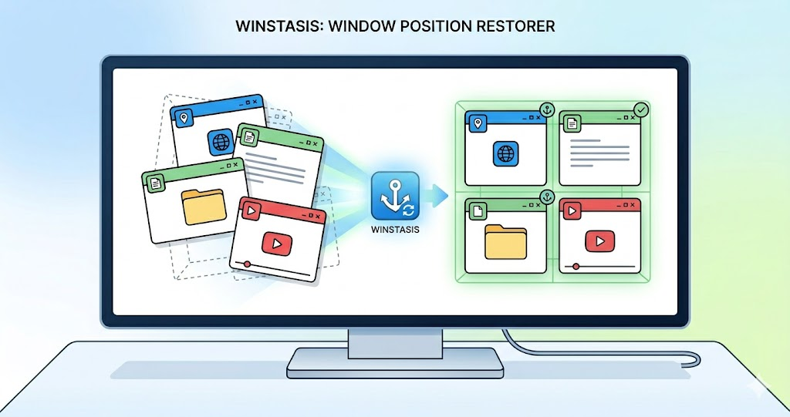

# 🪟 WinStasis

**A lightweight, native C# Window Session Manager built for power users.**



`winst` is a command-line utility designed to capture, save, and reliably restore the exact positions, sizes, states, and **Virtual Desktops** of Windows applications. It is built to maintain workspace state across reboots and ensure that application layouts, development environments, and auxiliary tools remain precisely where they belong.


## 🚀 Features

* **Contextual Geometry Capture:** Evaluates window show commands individually. Normal and snapped windows capture physical visible boundaries via the Desktop Window Manager (DWM). Minimized windows preserve their restored normal positions, avoiding off-screen placeholder coordinates. Maximized windows retain normal floating geometry mapped to the active monitor work area.
* **DWM Frame Margin Compensation:** Automatically compensates for Windows 10 and 11 invisible resize borders (`SM_CXSIZEFRAME + SM_CXPADDEDBORDER`). Adjacent snapped windows align flush with zero pixel overlap.
* **Ultrawide Snapped Column Persistence:** Preserves active snapped column and grid layouts on 21:9 and 32:9 displays without reverting to outdated pre-snap floating sizes.
* **Per-Monitor V2 DPI Awareness:** Initializes process-level DPI context to ensure coordinate calculations, monitor boundaries, and DWM bounds operate in physical screen pixels across displays with disparate scaling factors.
* **Two-Pass Hybrid Matching:** Pass 1 validates active handles against top-level application criteria (`WS_EX_APPWINDOW`, ownership, and cloaking) and exact titles. Pass 2 provides fallback process matching while excluding non-activating overlays, tool windows (`WS_EX_TOOLWINDOW`), and background helper hosts.
* **Omniscient Workspace Tracking:** Captures and restores window assignments across all Windows Virtual Desktops using COM interfaces, correctly reapplying pinned window states.
* **Diagnostic Telemetry:** Provides structured `--verbose` output detailing HWNDs, window class names, Win32 style flags, DWM bounds, margin calculations, and matching pass reasons.


## 🛠️ Usage & Installation

### Requirements
* **For Users:** Windows 10 or 11 (64-bit). No .NET runtime installation is required, as published releases are completely self-contained.
* **For Developers:** [.NET 10.0 SDK](https://dotnet.microsoft.com/download) is required. Dependencies are defined in the project files and restore automatically via NuGet.

### Global Installation (Add to PATH)
To use `winst` globally from any terminal, publish it as a self-contained executable:
```bash
# Build a standalone executable
dotnet publish WinStasis/WinStasis.csproj -c Release -r win-x64 --self-contained true -p:PublishSingleFile=true -o ./publish

# The resulting winst.exe is placed in ./publish/
# Add this folder to your system %PATH% environment variable.
```

### Storage Location
Saved session profiles are stored as JSON files in your local Windows AppData directory:
`%LOCALAPPDATA%\WinStasis\sessions\`

### Commands


```bash
# Save current layout across all Virtual Desktops
winst save coding

# Overwrite an existing profile with verbose diagnostic logging
winst save coding --force --verbose

# Short flags are supported in any order
winst save coding -f -v

# List all windows in a profile with Target IDs and Virtual Desktops
winst list coding

# Restore all windows in a profile
winst restore coding

# Restore a specific window by its Target ID
winst restore coding --target 5

# Restore with verbose diagnostic output
winst restore coding -t 5 -v
```

> **Note on Elevated Windows:** Windows User Interface Privilege Isolation (UIPI) prevents standard user processes from modifying windows owned by an Administrator process. To restore elevated applications (such as an Administrator terminal), run `winst` from an elevated prompt.


## 💾 Profile Storage & Format
Profiles are serialized as human-readable JSON files inside `%LOCALAPPDATA%\WinStasis\sessions\`.

### Session JSON Example
```json
{
  "ProfileName": "coding",
  "CreatedAt": "2026-10-26T22:00:00",
  "Windows": [
    {
      "TargetId": 1,
      "Hwnd": 462104,
      "ProcessName": "WindowsTerminal",
      "WindowTitle": "PowerShell",
      "X": 0,
      "Y": 0,
      "Width": 960,
      "Height": 1040,
      "ShowCmd": 1,
      "DesktopId": "cb9b56f8-276a-405f-b560-b4d97c759c98",
      "IsPinned": false
    }
  ]
}
```
* `ShowCmd`: `1` (Normal / Snapped), `2` (Minimized), `3` (Maximized).
* `DesktopId`: GUID of the Virtual Desktop. `00000000-0000-0000-0000-000000000000` represents an unassigned or global workspace.
* `IsPinned`: Set to `true` if the window is pinned to appear across all Virtual Desktops simultaneously.


## 🛤️ Future Directions & Offshoots
* **[vdtree: Verbose Window Inspector](https://github.com/amirf147/vdtree):** A read-only CLI tool providing structured metadata about the Windows desktop layer in a human-readable tree format.
* **[Caster UIA Context Engine](docs/research_ui_automation_vs_win32.md):** A service utilizing Microsoft UI Automation to track keyboard focus inside specific application panes for context-aware speech grammars.
* **Multi-Monitor Hardware Topology Mapping:** Investigating physical display EDID persistence and connection-loss remapping across dynamic docking events.
